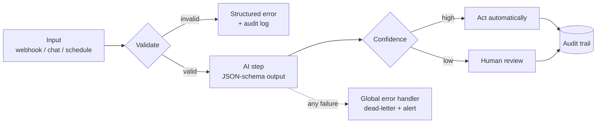

# Production n8n + AI Agent Systems

**Eight import-ready n8n workflows built the way real client systems are built:**
validated input, structured AI output, confidence-based routing, dead-letter logging.

[**Free 15-min workflow teardown**](https://go.anchornovahq.com) · [Portfolio](https://emmanuelthompson.anchornovahq.com)

---

## Why this repo exists

Most n8n examples are demos: a trigger, an LLM call, a Slack message. They break the first time a customer sends an empty message, a duplicate invoice, or a 40 MB attachment.

These eight systems are drawn from a portfolio of 19. Each one handles the unhappy paths: bad input, low-confidence AI answers, duplicates, failed notifications and outages. Nothing silently disappears.

> **Reported result:** a connected six-workflow suite delivered in two weeks with a client-reported $190K annual impact.

## What's inside

| # | System | What it does | Pattern on show |
|---|--------|--------------|-----------------|
| 01 | [Support & Knowledge Assistant](01-support-knowledge-assistant) | Chat agent answering from a pgvector knowledge base | RAG, confidence routing, escalation |
| 02 | [Invoice Processing (AP)](02-invoice-processing-ap) | Webhook / Gmail / Drive intake to OCR to approval | OCR, duplicate check, human approval |
| 03 | [Lead Qualification & Sales](03-lead-qualification-sales) | Validates, scores, routes and follows up on leads | AI scoring, rules routing, CRM sync |
| 04 | [Employee Onboarding & IT](04-employee-onboarding-it) | Plan, provisioning tasks, welcome flow, dashboard | Dead-letter log, timezone-safe dates |
| 05 | [Executive Ops Dashboard & BI](05-executive-ops-dashboard-bi) | Stripe + HubSpot + Jira + GA into one KPI report | Parallel fetch, alert engine |
| 06 | [Daily Executive Report](06-support-daily-executive-report) | 07:00 AI-written summary of yesterday's support | Strict output schema |
| 07 | [Global Error Handler](07-global-error-handler) | One error workflow for all the others | Dead-letter, throttling, AI triage |
| 08 | [Video Factory](08-video-factory-multi-user) | Form-driven video pipeline with human review | Access control, capacity checks |

## The architecture in one picture

## Design principles

Read [PATTERNS.md](PATTERNS.md) for the full list. The short version:

1. Validate before anything runs.
2. Structured AI output only. No parsing free text downstream.
3. Above the confidence threshold the system acts; below it, a human decides.
4. Failures and decisions go to a log, never only to a notification.
5. Notifications are non-blocking so an alert can't break the main flow.
6. Retry only where it is safe. Non-idempotent writes don't retry.

## Quick start

1. Import `07-global-error-handler` first.
2. Import any other workflow and set the handler as its **Error Workflow**.
3. Replace every `YOUR_*` placeholder and attach your own credentials.

Full steps in [SETUP.md](SETUP.md). All exports are sanitised and inactive.

## Stack

n8n · Gemini (chat, embeddings, structured output) · PostgreSQL + pgvector · Google Vision OCR · HubSpot · Stripe · Jira · Google Workspace · Slack · Gmail

## License

Released under the **PolyForm Internal Use License 1.0.0** (see [LICENSE](LICENSE)).

- **Allowed:** read, learn from, copy and modify these workflows for **your own organisation's internal operations**.
- **Not allowed:** redistributing them, reselling them, or delivering them (or their functionality) to clients or third parties as a product or service.
- **Need to do more?** Commercial and client-delivery licences are available. Get in touch via the link below.

Copyright (c) 2026 Emmanuel Thompson / AnchorNova Ltd. All rights reserved except as granted by the license. "AnchorNova" is a brand of AnchorNova Ltd; the license does not grant rights to use it.

## Work with me

Want a system like one of these running in your business?

**[Book a free 15-minute workflow teardown](https://go.anchornovahq.com)**: bring one painful process and leave with a concrete automation plan, whether or not we work together.

If this repo saved you time, a star helps other builders find it.
